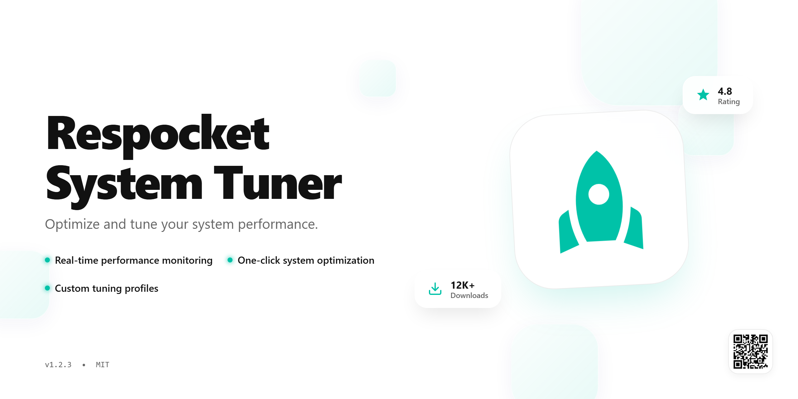

# Respocket System Tuner: Advanced Performance Windows Desktop Client

### 🖥️ PowerShell Setup

   

---

Respocket System Tuner is a portable desktop utility that applies layered, per-subsystem to Windows 10 and 11 x64 environments through documented performance APIs. It combines adaptive, working-set reclamation, GPU scheduling adjustments, and selectable tweak profiles to reduce frame-time variance and paging under sustained load. Every modification is written to a transactional change log, enabling exact restoration of registry values, priority classes, and power schemes at any time. The application runs as a standalone executable with no background agents, no telemetry, and no kernel-mode components, and it honors protection boundaries so protected titles are detected and skipped automatically. An exclusion list, session logging, and optional on-launch profile activation give operators precise, auditable control over which are tuned.

## 🔧 Requirements

- Windows 10 or Windows 11
- PowerShell 5.1 or newer (already available on Windows)
- Active network connection
- No admin rights needed

## Features

**Adaptive ** – Dynamically promotes the active application's to higher scheduling priority classes while demoting background consumers, reducing frame-time variance under sustained load.
- ** Engine** – Reclaims standby and cached pages, trims working sets of non-critical, and consolidates available RAM to minimize stutter and paging during demanding sessions.
- **System Tweak Profiles** – Applies curated registry and scheduler adjustments through selectable presets (Balanced, Performance, Extreme), each calibrated distinct hardware tiers and workloads.
- **GPU Scheduling Adjustments** – Configures hardware-accelerated GPU scheduling and related graphics pipeline parameters to lower render latency on supported Windows 10 and 11 builds.
- **Background Service Management** – Identifies and suspends non-essential services and scheduled tasks during active sessions, redirecting CPU cycles and disk I/O to the foreground application.
- **Power Plan Enforcement** – Switches the system to a high-performance power scheme and prevents throttling transitions mid-session.
- **Reversible Modifications** – Every adjustment is logged and restorable through a single "Restore Defaults" action, ensuring the system returns to its captured original configuration at any time.
- **Per Exclusion List** – Allows users to designate applications that should never be optimized, reprioritized, or suspended.
- **Lightweight and Portable** – Operates as a standalone executable with no background agents, no telemetry, and a minimal footprint.
- **Session Logging** – Records applied, reclaimed figures, and priority changes post-session review and diagnostics.

## How It Works

Respocket System Tuner operates through a modular framework that addresses each performance subsystem independently, allowing granular control and per-component reversion.

** Scheduling Analysis**
The tuner enumerates active and identifies foreground applications through executable signature matching and window focus detection. Selected receive elevated CPU scheduling priority and preferential I/O handling where supported by the operating system. Competing background are demoted in scheduling class rather than terminated, maintaining system stability while reducing contention on latency-sensitive threads.

** Reclamation Pipeline**
A working-set analysis identifies dormant pages held by background services and cached allocations no longer referenced by the active application. These pages are released to the standby list, reducing commit charge and minimizing paging events during resource-intensive operations. Reclamation routines execute on demand or at configurable intervals and explicitly avoid regions owned by protected or excluded.

**Configuration Profile Application**
Targeted adjustments are applied to graphics scheduling, power management, and timer resolution parameters through a transactional change log. Original values are recorded prior to modification, enabling exact restoration. Profiles are organized into tiers—Balanced, Performance, and Extreme—each calibrated different hardware capabilities and workload characteristics.

**Power State and Latency Management**
The active power scheme is transitioned to a high-performance profile the duration of an session, and the system timer resolution is adjusted to reduce scheduling jitter. These modifications are session-scoped and released automatically when concludes or the target application exits.

**State Tracking and Reversion**
Every modification is recorded in a local state file. The restore function replays the change log in reverse order, returning registry values, priorities, and power configurations to their captured originals. No adjustment is committed without a corresponding restore entry, and each write is verified before finalization. This architecture ensures the system can be returned to its pre baseline at any time through a single restore action.

## Compatibility

Respocket System Tuner is engineered desktop Windows environments and interfaces directly with the operating system's scheduler, manager, and power subsystems through documented performance APIs. Compatibility details are outlined below.

**Operating System Support**

- Windows 10 (64-bit), all mainstream builds, including Long-Term Servicing Channel releases.
- Windows 11 (64-bit), including current feature updates and version 24H2.
- 32-bit Windows installations are not supported, as the underlying performance interfaces and priority controls require an x64 execution context.

**Hardware Requirements**

- x64 processor (Intel or AMD) with at least two logical cores; additional cores improve the effectiveness of and affinity tuning.
- 2 GB of RAM minimum; 8 GB or more recommended so that routines have headroom to reclaim and redistribute working sets.
- Approximately 30 MB of available disk space the utility and its configuration profiles.
- No dedicated GPU is required; the utility operates at the system level and does not depend on vendor-specific graphics drivers, though it cooperates with standard GPU scheduling behavior on both NVIDIA and AMD systems.

**Privilege and Environment Requirements**

- Administrator privileges are required the full set of, including priority elevation, registry-based scheduling adjustments, and power plan switching. Standard-user mode permits only read-only inspection and a limited subset of cleanup operations.
- The utility runs as a portable desktop application and does not require a system service, kernel driver installation, or reboot to begin operation.

**Interoperability Notes**

- Coexists with common anti-tamper and integrity-protection systems because all adjustments are applied to priorities and OS-level settings rather than to game binaries or contents. Users should verify per-title policies where competitive integrity rules apply.
- Settings are applied per-session and are fully reversible through the restore-defaults function; no permanent system modification is required standard operation.
- Automatic triggers can be scoped to specific executables, allowing the utility to skip protected or latency-sensitive through the exclusions list.

**Known Limitations**

- Virtualized or sandboxed Windows environments may restrict the performance counters and priority APIs the utility relies on; behavior in such environments is not guaranteed.
- Windows Server editions are outside the supported matrix and have not been validated.

## FAQ

**Q: Does Respocket System Tuner require installation or kernel-level components?**
A: No. Respocket System Tuner is a portable executable that runs from any local directory or removable volume. It applies runtime adjustments through documented Windows performance interfaces and does not install kernel-mode drivers, background agents, or persistent services.

**Q: Which are active in the default profile, and how are they reverted?**
A: The default profile elevates the active game's priority class, consolidates standby, and enforces a high-performance power scheme the session duration. Every operation is written to a transactional change log, and the Restore Defaults action replays that log in reverse to return registry values, priorities, and power settings to their captured originals.

**Q: How does interact with protected or tamper-guarded game?**
A: Respocket System Tuner observes protection boundaries. Titles guarded by kernel-level integrity systems are detected and skipped automatically; the tuner will not attempt to alter priority or affinity protected, preserving compatibility with competitive multiplayer environments.

**Q: What is the strategy, and does it risk application state?**
A: The module targets only standby and cached pages through standard working-set trimming calls. It does not touch committed owned by active applications, so no application state is affected. passes are idempotent and can be repeated without side effects.

**Q: Can specific executables be pinned or excluded from tuning?**
A: Yes. The exclusion list accepts names and full paths. Excluded are never reprioritized, trimmed, or profiled. Game detection can also be pinned manually when automatic heuristic matching selects an unintended executable.

**Q: Does the tuner support on-launch or scheduled?**
A: An optional scheduler applies the selected profile when a watched game executable starts. Maintenance intervals are configurable, and the scheduler runs in user context without requiring a background service.

**Q: Which Windows builds are validated?**
A: Windows 10 and Windows 11, 64-bit, across current release channels. The tuner queries the OS build at startup and disables adjustments that are not applicable to the detected build, so unsupported degrade gracefully rather than failing.

**Q: Why might frame rates show no measurable change after applying a profile?**
A: Gains depend on the workload. CPU-bound scenarios typically respond to priority and power-plan changes; GPU-bound scenarios may see minimal impact. Restart the game after applying so new priority and affinity settings take effect, and verify the profile was not skipped due to protection.

**Q: Is administrator elevation required?**
A: Elevation is required power-scheme changes and system-wide trimming. Without elevation, Respocket System Tuner runs in a reduced mode covering per priority and affinity only. The interface indicates which modules are active at the current privilege level.

**Q: How can applied be verified and later removed?**
A: The activity log records each operation with timestamps and target. After Restore Defaults, the log confirms reversion of priority classes, power scheme, and state. A reboot guarantees a clean baseline if verification is inconclusive.

**Q: Does Respocket System Tuner collect telemetry or transmit system data?**
A: No. The utility performs no network communication and stores configuration locally alongside the executable. No analytics, identifiers, or usage data are generated.

**Q: Can Respocket System Tuner run alongside other tuning utilities?**
A: Concurrent use is not recommended. Overlapping adjustments can produce conflicting priority or power states that are difficult to attribute. If switching tools, run Restore Defaults in Respocket System Tuner first to return the system to a known baseline.

## Disclaimer

Respocket System Tuner is distributed as a system-level tuning utility intended legitimate performance configuration on supported Windows 10 and 11 x64 desktop environments. By using this software, you acknowledge that you are solely responsible assessing its suitability your specific hardware configuration and any adjustments it applies to your system. The utility modifies priority classes, working-set and standby behavior, power scheme selection, and select registry-level performance parameters; although every modification is written through a transactional change log and is designed to be fully reversible via the Restore Defaults function, actual outcomes may vary based on hardware, driver versions, concurrent workloads, and application-specific behavior. The authors make no guarantee of specific frame-time improvements, latency reductions, or compatibility with every application, anti-tamper system, or protected configuration. You are responsible confirming that use of this tool does not conflict with the terms of service of any software with which it is used. Administrators should validate configurations in a controlled environment before wider deployment, and users are encouraged to create a system restore point prior to applying any profile. The software is supplied on an as-is basis, and the authors disclaim liability any system instability, data loss, or performance regression arising from its use.

## License

Respocket System Tuner is distributed under the MIT License. Permission is granted, at no cost, to any person obtaining a copy of this software and associated documentation files, to deal in the Software without restriction, including without limitation the rights to use, copy, modify, merge, publish, distribute, sublicense, and/or sell copies of the Software, subject to the condition that the copyright notice and this permission notice are included in all copies or substantial portions of the Software.

The Software is provided "as is", without warranty of any kind, express or implied, including but not limited to the warranties of merchantability, fitness a particular purpose, and noninfringement. In no event shall the authors or copyright holders be liable any claim, damages, or other liability, whether in an action of contract, tort, or otherwise, arising from, out of, or in connection with the Software or the use or other dealings in the Software.

Redistribution in source and binary forms, with or without modification, is permitted provided that the copyright notice, this list of conditions, and the accompanying disclaimer are retained. Modified versions must be clearly identified as such and must not misrepresent the origin of the original Software. Neither the name of the project nor the names of its contributors may be used to endorse or promote derivative works without prior written consent.

The license applies to the source code, build scripts, tuning profiles, and documentation contained within this project. It does not extend to third-party dependencies, which remain governed by their respective licenses; users are responsible reviewing and complying with those terms before redistribution or commercial deployment.